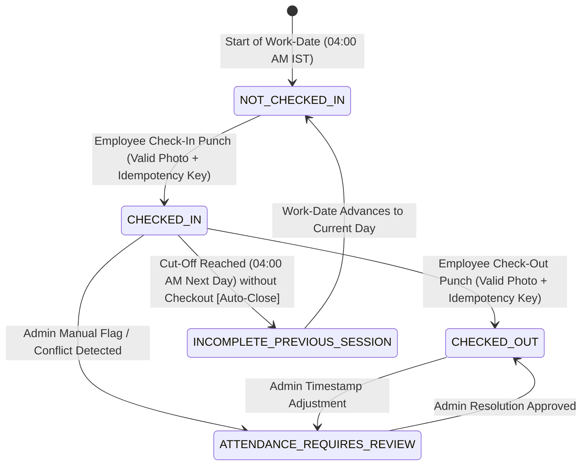

# Attendance State Machine Specification
## Staff Attendance Management System — Phase 2 Architecture Specification

**Document Version:** 1.0.0  
**Status:** Approved State Machine Baseline  

---

### 1. State Definitions

| State Name | Definition & Business Meaning | Permitted Kiosk Actions | Rejected Actions |
| :--- | :--- | :--- | :--- |
| **`NOT_CHECKED_IN`** | Employee has no active or completed attendance record for the current work-date. | `CHECK_IN` | `CHECK_OUT` |
| **`CHECKED_IN`** | Employee has successfully punched in for today; session is actively open. | `CHECK_OUT` | `CHECK_IN` |
| **`CHECKED_OUT`** | Employee has completed their daily attendance session (both check-in and check-out recorded). | None (Status display only) | `CHECK_IN`, `CHECK_OUT` |
| **`INCOMPLETE_PREVIOUS_SESSION`** | Employee failed to check out yesterday, and the daily cut-off time (04:00 AM) transitioned the session to `AUTO_CLOSED`. | `CHECK_IN` (For new workday) | `CHECK_OUT` (For closed session) |
| **`ATTENDANCE_REQUIRES_REVIEW`** | Session has an anomaly (e.g., manual correction, flagged mismatch, or admin investigation). | As determined by Admin | Kiosk punch depends on resolution |

---

### 2. State Transition Diagram

---

### 3. Transition Rules & Database Invariants

#### Transition T1: `NOT_CHECKED_IN` ➔ `CHECKED_IN`
- **Trigger:** Employee submits Check-In via kiosk.
- **Guards:**
  1. Employee `status == 'ACTIVE'`.
  2. No existing record for this `(employee_id, work_date)`.
  3. Photo is non-null, valid format, size ≤ 2MB.
- **Database Action:**
  - Insert `attendance_photos` (in-photo metadata).
  - Insert `attendance_sessions` with `in_time = CURRENT_TIMESTAMP`, `status = 'INCOMPLETE'`, `out_time = NULL`.
  - Enforced by partial unique index `uk_single_open_session`.

#### Transition T2: `CHECKED_IN` ➔ `CHECKED_OUT`
- **Trigger:** Employee submits Check-Out via kiosk.
- **Guards:**
  1. Employee `status == 'ACTIVE'`.
  2. Exactly one open session exists with `out_time IS NULL`.
  3. Current server time > `in_time`.
  4. Photo is non-null, valid format, size ≤ 2MB.
- **Database Action:**
  - Insert `attendance_photos` (out-photo metadata).
  - Update `attendance_sessions` setting `out_time = CURRENT_TIMESTAMP`, `out_photo_id`, `status = 'PRESENT'`.
  - Increments `@Version` column. Clears partial index `uk_single_open_session`.

#### Transition T3: `CHECKED_IN` ➔ `INCOMPLETE_PREVIOUS_SESSION` (Auto-Close)
- **Trigger:** Daily cut-off cron job fires at 04:00 AM IST.
- **Guards:**
  1. `attendance_sessions.work_date < CURRENT_WORK_DATE`.
  2. `out_time IS NULL`.
- **Database Action:**
  - Update `attendance_sessions` setting `status = 'AUTO_CLOSED'`.
  - Inserts `audit_logs` entry: `actor_type = 'SYSTEM'`, `reason = 'Automated daily cut-off closure'`.
  - Releases partial index constraint so the employee is free to check in for the new day.

#### Transition T4: Any State ➔ `ATTENDANCE_REQUIRES_REVIEW` / `MANUAL_OVERRIDE`
- **Trigger:** Admin manual adjustment via Dashboard.
- **Guards:**
  1. Admin authenticated (`SUPER_ADMIN` or `HR_ADMIN`).
  2. Non-empty `reason` string provided (min 10 characters).
  3. Corrected $T_{\text{out}} > T_{\text{in}}$.
- **Database Action:**
  - Update `attendance_sessions` with new timestamps and status `MANUAL_OVERRIDE`.
  - Insert full JSONB delta into `audit_logs`.
